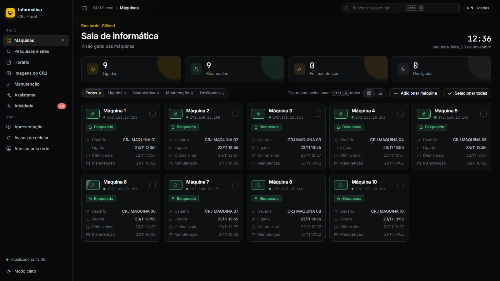
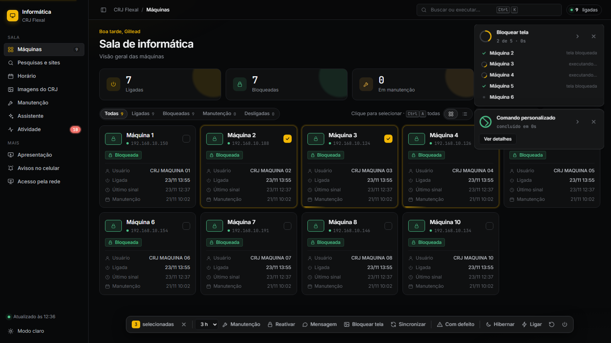
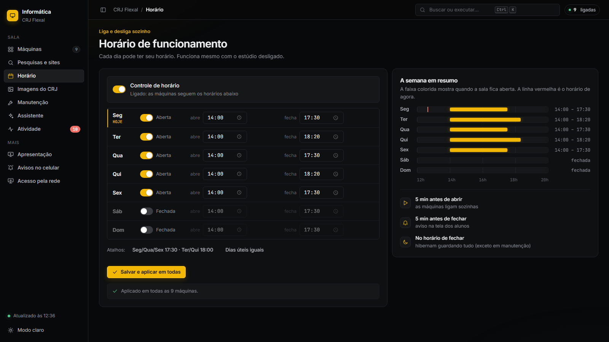
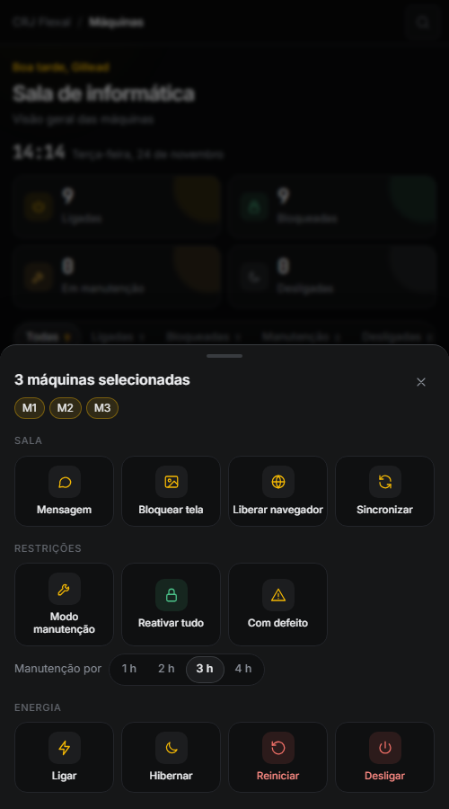
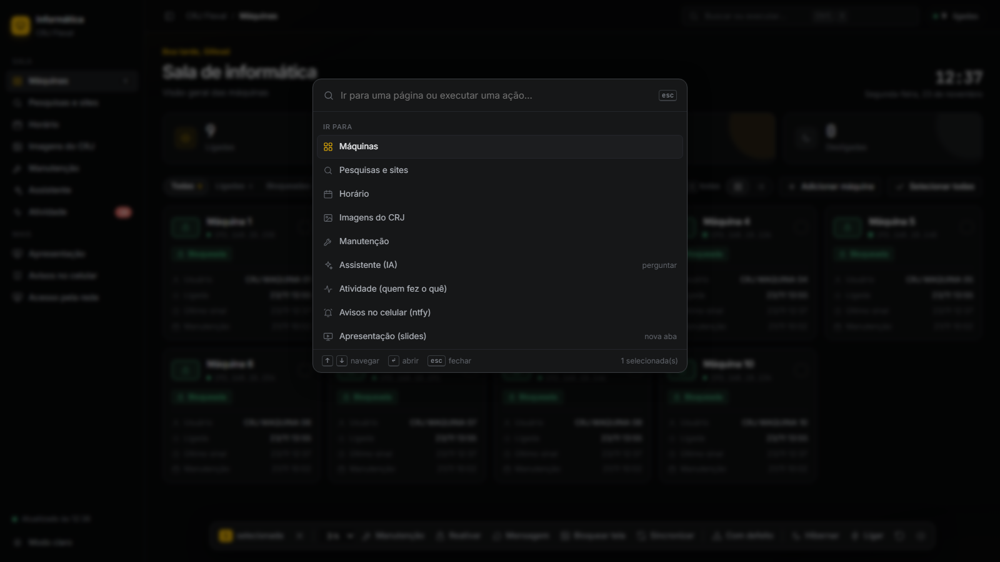
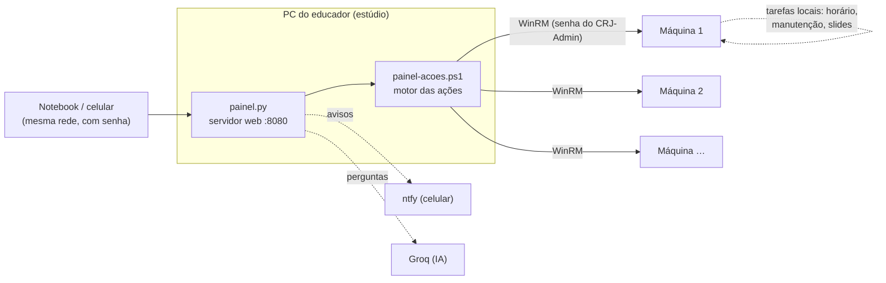

# Painel da Informática

**Controle a sala de informática inteira a partir de um único PC, de graça.**

Feito para o laboratório de informática do **CRJ Flexal**, onde jovens usam os computadores todos os dias.
Ele protege as máquinas, liga e desliga a sala no horário, mantém tudo atualizado e mostra o que está acontecendo,
num painel que abre no PC do educador, no notebook ou no celular.

Usa só o que já existe no Windows (PowerShell, WinRM, AppLocker, Agendador de Tarefas), mais Python e o Veyon.
**Não tem servidor pago, mensalidade nem nuvem obrigatória.**



---

## O que ele faz

### 🔒 Proteção das máquinas
- O aluno usa uma **conta comum**, sem ser administrador.
- O **AppLocker** bloqueia programas baixados ou instalados pelos alunos, mas os jogos e programas que já estavam instalados continuam funcionando.
- No **Chrome e no Edge**, as políticas bloqueiam aba anônima, perfil convidado, apagar histórico e extensões, e ativam a busca segura e o DNS com filtro familiar.
- O **modo manutenção** libera tudo por 1 a 4 horas para o educador instalar algo, e volta sozinho.
- O botão **Liberar navegador** libera só o navegador e mantém o bloqueio de instalação.
- O **modo defeito** tira de uso uma máquina com problema: aparece um aviso na tela e a conta do aluno fica desativada.

### 🖥️ Ações em massa, com progresso ao vivo
Ligar pela rede (Wake-on-LAN), hibernar, reiniciar, desligar, enviar mensagem para a tela e bloquear a tela.
Um cartão mostra o andamento máquina por máquina, e as ações perigosas pedem **"segure para confirmar"**.



### ⏰ Horário automático
- Cada dia da semana pode ter um horário de funcionamento.
- As máquinas **ligam sozinhas** antes da aula, **avisam os alunos** antes de fechar e **hibernam** no fechamento.
- Tudo isso funciona mesmo com o PC do educador desligado.



### 🔧 Manutenção sem ninguém mexer
- **Toda semana**, cada máquina acorda sozinha, limpa arquivos temporários, roda o antivírus, instala as atualizações do Windows e volta a hibernar.
- Uma **rede de segurança** confere depois se alguma máquina ficou ligada. No fim de semana, essa conferência roda na própria máquina.
- A **sincronização automática** percebe a máquina que ficou para trás (por exemplo, porque estava desligada num dia de mudança) e corrige sozinha.
- **Máquina nova** entra no painel só pelo IP. Se o roteador trocar o IP de uma máquina, o painel a encontra pela placa de rede.

### 🔎 Pesquisas e alertas
- O histórico de pesquisas e sites do Chrome e do Edge fica **só no painel**.
- As pesquisas que contêm **palavras de alerta** editáveis (apostas, conteúdo adulto, automutilação…) aparecem destacadas.

### 🖼️ Imagens da instituição
Fotos em slides na tela de bloqueio e no papel de parede, com editor de recorte no próprio painel.

### 📱 No celular, com avisos
- O painel tem um layout próprio para celular, com abas embaixo e ações num painel que sobe da parte de baixo.
- **Avisos no celular** pelo [ntfy](https://ntfy.sh) chegam quando:
  - aparece uma pesquisa com alerta;
  - uma máquina some da rede no horário de aula;
  - a manutenção falha;
  - o antivírus encontra uma ameaça.

<p align="center"></p>

### 🤖 Assistente com IA (opcional)
- Faz consultas e diagnósticos em português, como "alguma máquina com problema?" ou "diagnostica a Máquina 4", usando o [Groq](https://console.groq.com), que é gratuito.
- **Ele só propõe ações**: quem confirma e executa é o educador.
- O Assistente nunca recebe o texto das pesquisas dos alunos.

### ⌨️ E mais
- Barra de comandos (`Ctrl+K`) e atalhos de teclado.
- Aba **Atividade**, com quem fez o quê.
- Temas claro e escuro.
- Modo apresentação, com slides para mostrar o projeto em reuniões.



---

## Como funciona



- O **painel** (`painel/painel.py`) é um servidor Python sem dependências externas. Ele consulta as máquinas a cada 30 segundos e executa as ações chamando `painel-acoes.ps1`, que fala com cada máquina por **WinRM**.
- Nas máquinas, o que precisa acontecer sozinho (horário, manutenção semanal, slides, rede de segurança) roda em **tarefas agendadas locais**. Por isso a sala continua funcionando com o PC do educador desligado.
- O acesso de fora do PC do educador é limitado à rede local e exige senha. As máquinas só aceitam comandos da rede da sala, com a senha do administrador.

## Requisitos

- **Máquinas da sala:** Windows 10 ou 11 **Pro**. O AppLocker e o WinRM pedem a edição Pro.
- **PC do educador:** Windows com [Python 3](https://www.python.org) e [Veyon Master](https://veyon.io) (opcional, para ver as telas).
- Todos na **mesma rede local**.
- **Opcional:** app ntfy no celular e uma chave gratuita do Groq.

## Instalação

1. **PC do educador:** baixe este repositório e prepare:
   - Instale o Python 3 em `C:\Python314`. Os scripts usam esse caminho; se for outro, ajuste em `preparar-estudio.ps1` e `Painel da Informatica.vbs`.
   - Baixe o instalador do [Veyon](https://veyon.io) e salve como `instaladores\veyon-setup.exe`.
   - Crie as pastas vazias `relatorios` e `chaves` na raiz do projeto.
   - Ajuste a faixa de IP da sua rede (o padrão é `192.168.10.x`) em `preparar-estudio.ps1`, `servidor.py` e `painel/painel.py`.
   - Rode como administrador:
     ```powershell
     .\preparar-estudio.ps1     # firewall do servidor de preparo, WinRM (cliente), Veyon e chaves do Veyon
     .\salvar-senha.ps1         # guarda a senha do administrador das máquinas (criptografada com DPAPI)
     ```
2. Copie `computadores.exemplo.csv` para `computadores.csv`. Pode deixar só o cabeçalho: as máquinas entram pelo painel.
3. Abra **`Painel da Informatica.vbs`**. Ele liga o servidor e abre o painel como programa.
4. **Em cada máquina da sala**, entre como administrador e rode o comando que o painel mostra em **Adicionar máquina**:
   ```powershell
   irm http://IP-DO-PC-DO-EDUCADOR:8000/preparar-pc.ps1 | iex
   ```
   O script cria a conta `CRJ-Admin`, transforma a conta do aluno em usuário comum, aplica as restrições, libera o WinRM e instala o Veyon.
5. No painel, use **Adicionar máquina**, digite o IP da máquina e clique em **Sincronizar**.

> Os nomes (`CRJ-Admin`, "Educador Gillead", as imagens) são da instalação original. Ajuste-os para a sua instituição em `preparar-pc.ps1`, `restricoes.ps1` e nos textos do painel.

## Estrutura

| Caminho | O que é |
|---|---|
| `painel/painel.py` | Servidor do painel: API, tarefas, rotinas, avisos e Assistente |
| `painel/painel-acoes.ps1` | Motor das ações nas máquinas (WinRM) |
| `painel/index.html` | Interface (arquivo único, sem framework) |
| `painel/login.html`, `apresentacao.html` | Tela de login pela rede e modo apresentação |
| `painel/manutencao-semanal.ps1` | Manutenção semanal + rede de segurança (roda nas máquinas) |
| `restricoes.ps1` | Restrições de cada máquina (AppLocker + navegadores) |
| `preparar-pc.ps1`, `servidor.py` | Preparo de uma máquina nova |
| `preparar-estudio.ps1`, `salvar-senha.ps1` | Preparo do PC do educador |
| `pendrive-maquinas/`, `maquina-1-bloqueio/` | Scripts para rodar manualmente por pendrive (liberar o estúdio, diagnóstico de rede, modo defeito) |
| `instaladores/instalar-impressora-brother.ps1` | Exemplo de instalação de impressora de rede pelo nome |

## Privacidade e segurança

- **Ficam fora do repositório** (ver `.gitignore`): a senha do administrador, a chave do Veyon, a configuração do painel (senha de acesso, tópico do ntfy, chave do Groq), o histórico de pesquisas, as fotos e a lista real de máquinas.
- O histórico de pesquisas fica **só no PC do educador**. Os avisos no celular trazem apenas a máquina e a quantidade de alertas, nunca o texto pesquisado.
- A senha do administrador fica guardada com **DPAPI**, então só a conta do educador naquele PC consegue usá-la.
- Os jovens e as famílias devem saber que o uso da sala é monitorado. Siga as regras da sua instituição e da LGPD.

## Limitações conhecidas

- O painel roda no PC do educador. Com ele desligado, o painel e os avisos do dia a dia param, mas o horário, a manutenção e as restrições continuam nas máquinas.
- Sem reserva de IP no roteador, o IP das máquinas pode mudar. O painel se adapta, mas reservar os IPs no roteador é o ideal.
- Feito e testado em uma sala com 9 máquinas Windows 11 Pro. Em outros ambientes pode precisar de ajustes.

## Licença

Este projeto usa a [licença MIT](LICENSE): você pode usar, copiar, modificar e distribuir, inclusive em outras instituições, desde que mantenha o aviso de direitos autorais. O software é oferecido "como está", sem garantia.

---

Feito por **Gillead**, educador do CRJ Flexal, com a ajuda do Claude (Anthropic).
